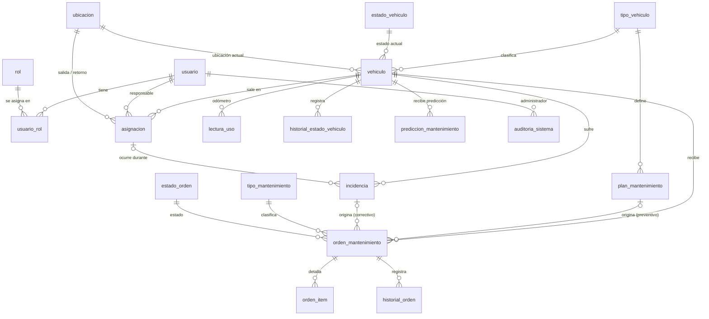

# Modelo de datos

Relaciones principales del esquema (`db/schema.sql`). Las claves foráneas son todas
reales; los historiales y la auditoría no se muestran con todos sus vínculos para
mantener el diagrama legible.

## Tablas

| Grupo | Tablas |
| --- | --- |
| Identidad | `usuario`, `rol`, `usuario_rol` |
| Catálogos | `ubicacion`, `tipo_vehiculo`, `estado_vehiculo`, `estado_orden`, `tipo_mantenimiento` |
| Operación | `vehiculo`, `asignacion`, `lectura_uso` |
| Mantenimiento | `plan_mantenimiento`, `orden_mantenimiento`, `orden_item`, `incidencia` |
| Trazabilidad | `historial_estado_vehiculo`, `historial_orden`, `auditoria_sistema` |
| Predicción | `prediccion_mantenimiento` |

## Vistas

| Vista | Para qué sirve |
| --- | --- |
| `v_ultima_lectura` | Última lectura de cada vehículo y días sin lectura. |
| `v_lecturas_sospechosas` | Lecturas con un salto implausible de odómetro (posible error de tipeo). |
| `v_ritmo_uso` | Km por día de cada vehículo en los últimos 90 días. |
| `v_ultimo_servicio` | Último servicio preventivo cerrado de cada plan por vehículo. |
| `v_proximo_servicio` | Km, días y fecha estimada hasta el próximo servicio de cada tarea. |
| `v_costo_por_vehiculo` | Costo de mantenimiento total y por km sobre el período registrado. |

## Reglas que hace cumplir la base de datos

- Un vehículo no puede tener dos asignaciones en curso a la vez (índice único parcial).
- Solo sale un vehículo `DISPONIBLE` (trigger, con bloqueo de la fila contra salidas simultáneas).
- El retorno exige odómetro y ubicación; el odómetro de retorno no puede ser menor que el de salida.
- Una lectura de odómetro no puede contradecir el orden temporal de las anteriores del mismo vehículo.
- Salida y retorno generan solos la lectura de odómetro, el cambio de estado y el historial.
- El estado de una asignación se deriva de sus fechas (columna generada), así que no puede contradecirlas.
- Un plan de mantenimiento exige al menos un intervalo (km, días u horas).
- El email de usuario es único sin distinguir mayúsculas.
